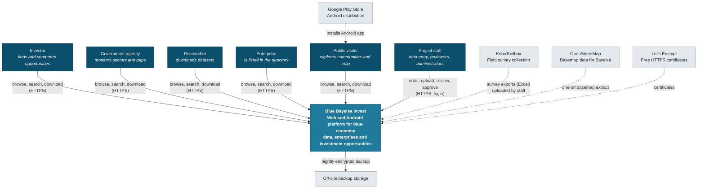
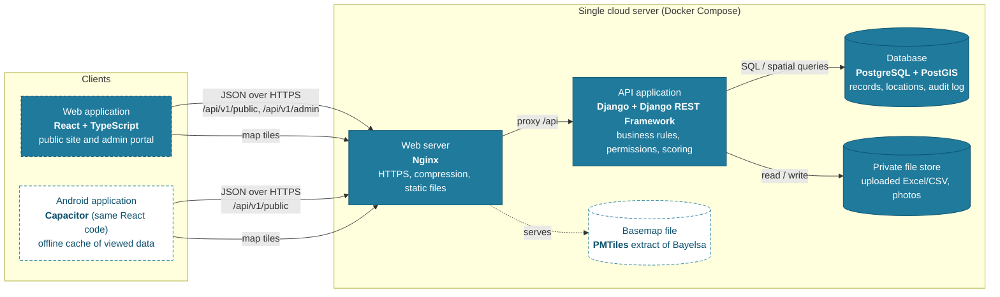
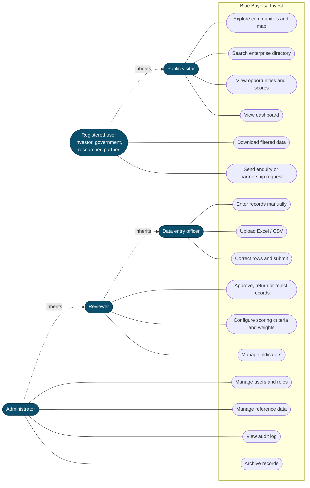
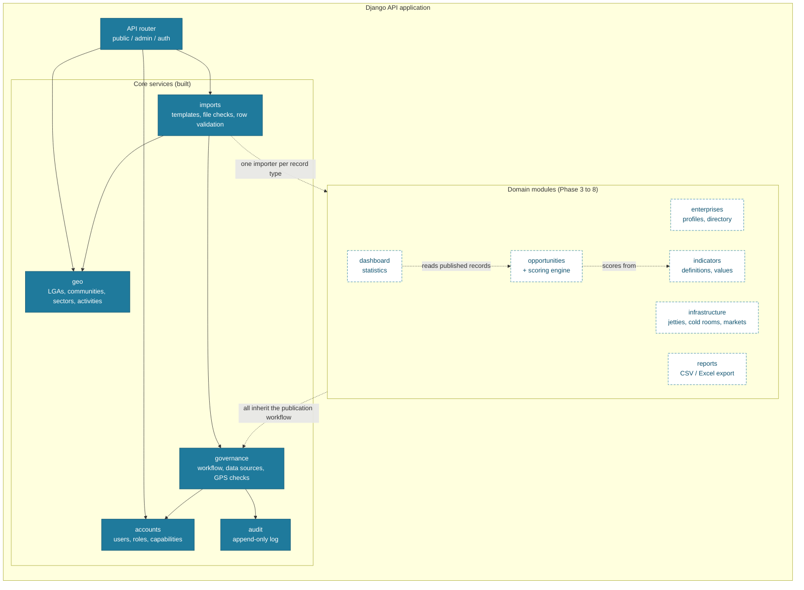
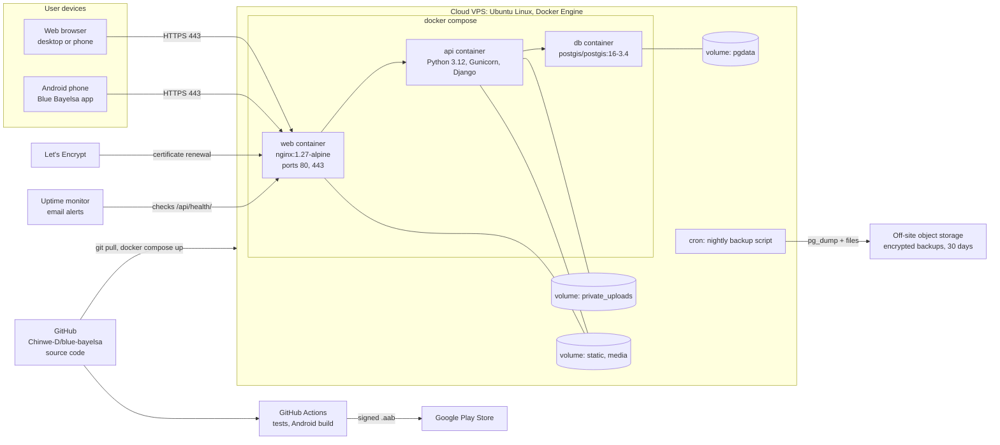
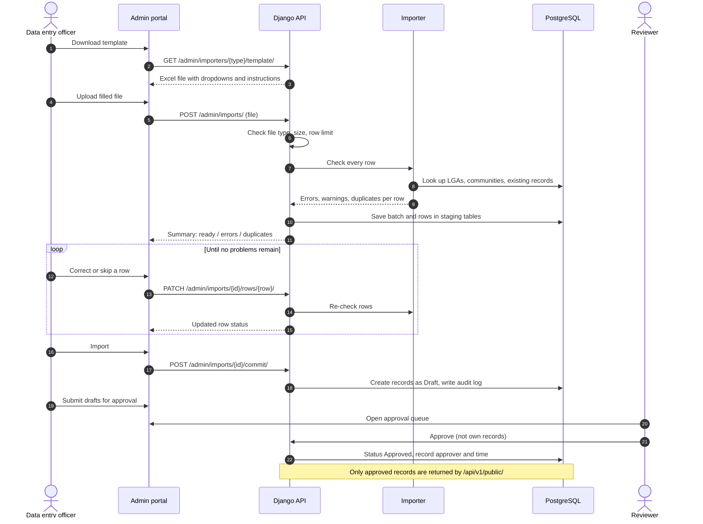
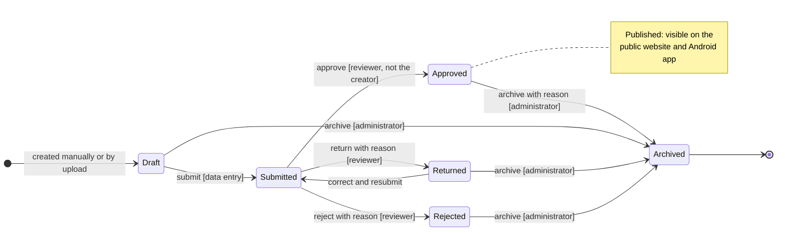
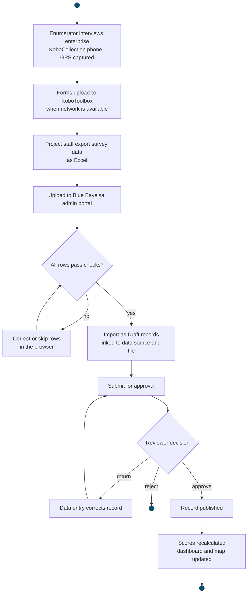
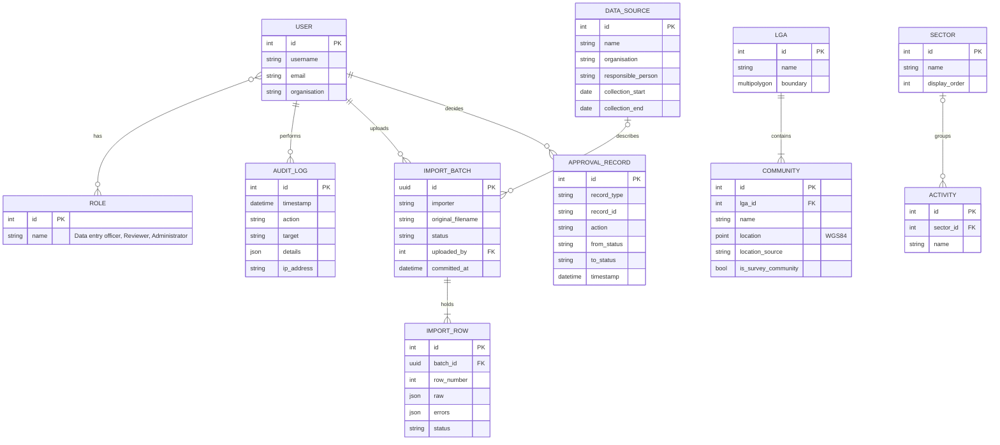

# Blue Bayelsa Invest: architecture diagrams

Standard notations: C4 model (context, containers) and UML (use case, component, deployment, sequence, state machine, activity), plus an entity-relationship diagram. Sources are Mermaid (`*.mmd`) and render directly on GitHub. Regenerate with `python docs/architecture/diagrams.py`.

## 1. System context (C4 level 1)

*C4 model: system context.* Who uses the platform and which outside systems it depends on. The blue box is the system we are building; grey boxes are external.

## 2. Containers (C4 level 2)

*C4 model: container diagram.* The deployable parts. Everything server-side runs on one affordable cloud server. The web app and Android app share one codebase and one API.

## 3. Use cases

*UML use case diagram.* What each role can do. Each role includes everything the role above it can do. Public browsing needs no account.

## 4. Backend components

*UML component diagram.* Modules inside the API application. Solid boxes are built and tested; dashed boxes are planned and depend on the field questionnaire.

## 5. Deployment

*UML deployment diagram.* Where each part runs in production. One virtual server of about 2 vCPU and 4 GB RAM is enough for the pilot.

## 6. Bulk upload and approval

*UML sequence diagram.* What happens when staff upload a spreadsheet. Nothing reaches the public until a second person approves it.

## 7. Record publication workflow

*UML state machine diagram.* Every enterprise, indicator value, opportunity and infrastructure record follows this life cycle. It is enforced on the server and every transition is logged.

## 8. Data flow from field to public

*UML activity diagram.* The end-to-end path of research data, from the community to the dashboard.

## 9. Current data model

*Entity-relationship diagram (crow's foot).* Tables built so far. Enterprises, indicators, infrastructure, opportunities and scoring tables will be added in Phase 3 once the questionnaire is available.

